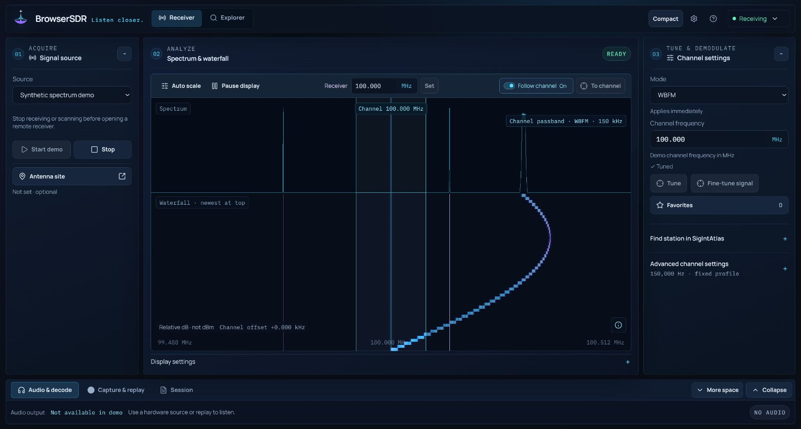

# BrowserSDR

**Explore the radio spectrum from your browser.**

BrowserSDR turns a supported USB radio into a browser workspace for listening, discovering signals and decoding broadcasts and data. Connect your receiver, tune a signal, and see what's happening across the spectrum—without installing a desktop SDR application.

**[Open BrowserSDR](https://browsersdr.com)** · [Getting started](https://browsersdr.com/getting-started/) · [Receiver compatibility](https://browsersdr.com/supported-devices/)

*FM reception with live signal activity and decoded station information.*

## What you can do

- **Listen to radio.** Tune FM broadcasts with RDS station information, AM, narrowband FM, single sideband and Morse audio. Digital radio reception includes DAB+.
- **Explore the spectrum.** Watch signals appear in the live spectrum and waterfall, click to tune, consult band guides, and use Explorer for scans and field surveys. Save useful frequencies as favorites.
- **Decode more than audio.** Explore aircraft positions, ship messages, weather-balloon telemetry, selected wireless sensors, pager messages, amateur text and radio images. Supported modes include ADS-B, AIS, APRS, POCSAG (512/1200/2400 bit/s), RTTY, NAVTEX, WEFAX and SSTV, with maps or dedicated results views where applicable.
- **Record and revisit.** Save short audio clips as WAV, rewind recent audio, or record radio samples (I/Q) to replay and investigate later. Export compatible captures as SigMF for use with other radio tools.

Reception depends on your receiver, antenna, location and signal conditions. Decoder availability and real-world validation vary by mode; some newer decoders still await off-air verification.

## Start with your receiver

You'll need **desktop Google Chrome**, a supported USB SDR and an antenna suited to the band you want to receive.

1. Connect your receiver and open [BrowserSDR](https://browsersdr.com).
2. Select your receiver in **Signal source**, connect, and choose it in Chrome's USB dialog.
3. Choose a mode and frequency, then start receiving. For a first listen, try **WBFM** on a strong local FM station.

**RTL-SDR and HackRF Pro are the stable desktop receivers.** HackRF One is experimental; bladeRF and USRP profiles are available with additional validation limits. Other browsers and receiver/mode combinations need their own checks. See [compatibility and setup](https://browsersdr.com/supported-devices/) for details, including USB permissions and driver requirements.

RTL-SDR also offers **3.2 MS/s (experimental)** in Device details & settings. It provides a wider spectrum window and native I/Q captures, but some dongles or USB hosts lose samples at this rate. Select 2.4 MS/s if audio or decoding breaks up. Existing defaults are unchanged; ordinary RTL I/Q cannot prove loss-free reception.

**Airspy R2 / Mini support is experimental.** Device details & settings offers the device's advertised sample rates, Linearity/Sensitivity presets, manual LNA/mixer/VGA gain, independent AGC, 12-bit USB packing, conversion filters, filtered decimation, frequency correction and explicit bias-tee power. Captures contain converted complex I/Q and export as 16-bit SigMF. Attached R2-profile hardware has received FM/RDS at 10 MS/s in Chrome; Mini and other reception modes need physical validation. Airspy HF+ uses a separate protocol and is not supported by this driver.

## Learn more and help improve BrowserSDR

Browse the [wiki](https://github.com/cybearde/browsersdr/wiki), read [what's changed](CHANGELOG.md), or follow the [development guide](https://github.com/cybearde/browsersdr/wiki/Development). Found a problem? [Open an issue](https://github.com/cybearde/browsersdr/issues) with your receiver, browser and steps to reproduce it. You can also share results through **Compatibility & tests** in the app's help menu.

BrowserSDR is receive-only. Licensed under [PolyForm Perimeter 1.0.1](LICENSE); bundled components retain their own licenses. See [third-party notices](THIRD_PARTY_NOTICES.md).

Shared RF frequency Search uses the reviewed public SigIntAtlas catalog without an account.
**Automatic** checks the live catalog and falls back to a dated saved copy when unavailable;
**Live** shows only current live results; **Saved** searches the saved public copy without a
catalog request. Revision, publication and last-live-check times make the source visible.
Saved copies can include subsequently changed or withdrawn profiles. Station search keeps
its existing live reference checks, and Preview/Apply remains deliberate.

The bundled public snapshot is generated from Atlas's public export with
`node scripts/update-frequency-snapshot.mjs ATLAS-EXPORT.json`; edit/review the catalog in
Atlas, then regenerate this delivery copy rather than maintaining a second catalog here.
